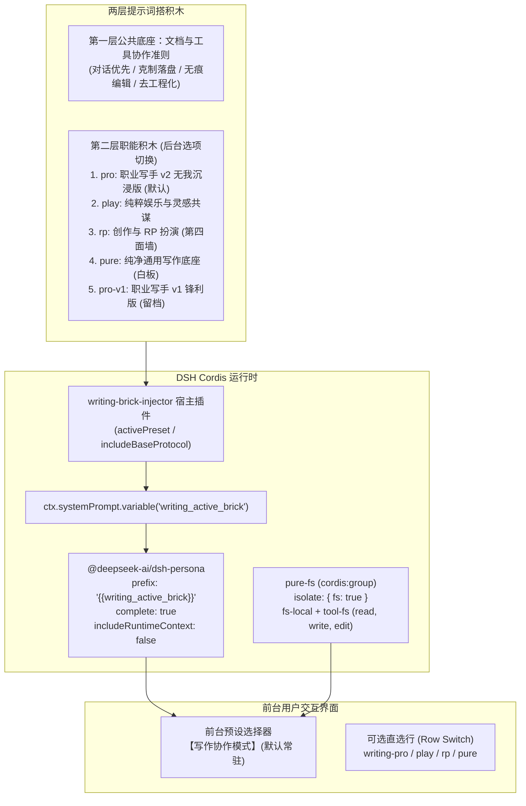

# chuanban-dsh-writingset

> **DeepSeek Harness (DSH) 纯净写作协作模式插件（Writing Preset Bundle）**  
> 消除编程噪音 · 最小文件工具集 · 两层搭积木提示词 · 后台动态选项注入

## 安装

```sh
dsh plugin --profile writing add https://github.com/Anarcadia/chuanban-dsh-writingset/releases/latest/download/chuanban-dsh-writingset.tgz
dsh web    # 或在 DSH Desktop 中选择 writing profile
```

- 未安装 dsh CLI：把上面的 `dsh` 换成 `npx @deepseek-ai/dsh`
- DSH Desktop 用户：设置 → 插件 → 安装框直接贴 URL
- 连同暖纸皮肤一起装：`dsh plugin --profile writing add <上面 URL> https://github.com/Anarcadia/chuanban-dsh-theme/releases/latest/download/chuanban-dsh-theme.tgz`

装完默认进入「职业写手」模式；pro / play / rp / pure 四个职能预设与「工作区文档注入」开关，在设置的「写作协作配置」面板中热切换（无需重启）。

---

本项目是 **[Issue D147](../../../issue/issue-D147-dsh-minimal-writing-collab-preset.md)** 的交付成果，专为日常文学创作、角色对戏、灵感构思与 Markdown 本地文档协作打造。它与 **[Storydesk 写作工作台](../../../issue/issue-D126-chuanban-xiezuo-gongzuotai-zonggang.md)**（D138/D139）在创作哲学上**完全内核等效**，区别在于本插件依托 DSH 底层基础设施原生运行。

---

## 核心架构设计



### 1. 零编程污染上下文净化
- **独占提示词**：主预设使用 `complete: true`，在组装瀑布流终点将提示词强制截断为单一的纯净写作指令，彻底清除 DSH 默认的数千字“资深全栈工程师”提示词与编程规范。
- **静音沙箱上下文**：`includeRuntimeContext: false` 静音沙箱策略与审批机制说明。
- **作用域隔离剥离沙箱参数**：在 `cordis:group` 内启用 `isolate: { fs: true }`，彻底移除 `write/edit` 工具 Schema 中的 `sandbox_permissions` 与 `justification` 参数。

### 2. 两层搭积木提示词体系
- **第一层（公共底座）**：`BASE_TOOL_PROTOCOL`（去工程化、对话优先、克制落盘、无痕编辑）。
- **第二层（职能人设）**：四大初始预设（`pro` / `play` / `rp` / `pure`）+ `pro-v1` 锋利版留档备选。

---

## 四大初始预设对照表

| 预设 ID | 名称 | 定位与核心特色 | 提示词核心导向 |
|:---|:---|:---|:---|
| **`pro`**<br>*(默认)* | **职业写手**<br>*(v2 无我沉浸版)* | **标准测试版**。以“忘我”为最高职业操守，消除一切抽离感与冷酷姿态，将工作区设定与世界观作为唯一准则。 | 彻底杜绝脱离语境的免责声明、道德评判或温和化稀释，将其视为导致世界观部件失效的严重失职。 |
| **`play`** | **纯粹娱乐**<br>*(灵感共谋版)* | **随性脑洞与快感导向**。不审视世俗价值，不强行升华立意，与作者共同推进私密趣味或荒诞脑洞。 | 顺着抛出的苗头大胆推演，把好玩和爽快的体验推到极致。 |
| **`rp`** | **创作与 RP 扮演**<br>*(第四面墙版)* | **全浸入式叙事与虚构对戏**。严守第四面墙，绝不出戏以 AI 视角做元叙事点评。 | 用感官细节、动作张力推进场面（Show, don't tell），查阅与记录文档作为纯后台静默动作。 |
| **`pure`** | **纯净通用写作底座**<br>*(零预设人设白板)* | **纯白板模式**。仅挂载第一层文档与工具协作准则，不设定任何预置角色偏向。 | 适合由首轮 Prompt、外部 Skill 或工作区文档完全自由定义角色。 |
| **`pro-v1`**<br>*(留档)* | **职业写手 v1**<br>*(第一性原理锋利版)* | **锋利效率导向**。强调不惜代价达成创作目的，将文本视为功能性部件。 | 保留供实测对照比较 v1 与 v2 体感。 |

---

## 后台预设切换的三种方式

本插件前台预设选择器始终保持优雅统一的**「写作协作模式」**，具体注入哪块职能积木由后台选项决定：

### 方式 1：DSH 客户端后台可视化配置面板（推荐）
打开 DSH Web / Desktop 客户端：
1. 点击左侧导航栏 **「插件」**；
2. 找到 `chuanban-dsh-writingset`，进入详情页；
3. 在顶部的「写作协作模式积木配置」卡片中，通过下拉框在 5 个预设中自由选择，并可实时预览组装后的完整 System Prompt。

### 方式 2：使用命令行一键切换 CLI 工具
在终端项目根目录下：
```bash
# 查看所有可用预设积木及当前激活项
node scripts/switch-preset.mjs --list

# 预览指定预设（如 play）拼接后的完整 System Prompt
node scripts/switch-preset.mjs --show play

# 一键切换为纯粹娱乐模式 (play)
node scripts/switch-preset.mjs play

# 一键切回职业写手模式 (pro)
node scripts/switch-preset.mjs pro
```

### 方式 3：直接编辑 `cordis.patch.yml`
打开项目根目录下的 `cordis.patch.yml`，修改 `writing-brick-injector` 的配置项：
```yaml
- id: writing-brick-injector
  name: 'chuanban-dsh-writingset'
  config:
    activePreset: rp            # 可填 pro / play / rp / pure / pro-v1
    includeBaseProtocol: true
    customPromptOverride: ''    # custom 模式下生效的自定义工作区提示
    workspacePromptMode: off    # off / custom / workspace（三选一，见下表）
    customPromptBehavior: append # custom 模式行为：append 追加 / replace 整段替换
```

> **进阶直选模式**：若希望将某个预设直接并列展示在前台选择器中，可在 DSH 插件详情页将对应预设行（如 `preset-writing-play`）的开关（Row Switch）开启即可。

---

## 工作区提示三模式（Phase 7）

在后台面板「工作区提示模式」三选一（仅作用于主预设「写作协作模式」；四个直选预设行保持静态不受影响）：

| 模式 | 行为 | 适用场景 |
|:---|:---|:---|
| **初始纯净**（`off`，默认） | 仅双层积木（职能积木 + 文档与工具协作准则），不读取工作区任何文档 | 开箱即用的纯净写作 |
| **自定义填写**（`custom`） | 后台填写自定义工作区提示：`追加` 在初始提示之后拼接；`替换初始提示` 整段接管（面板「用当前初始提示填充编辑」按钮一键带入当前组装结果再改） | 有本项目专属协作规则但不落文件 |
| **工作区识别**（`workspace`） | 会话组装系统提示词时，宿主自动读取会话工作目录的基础设施文档并追加在初始提示之后 | 与 Storydesk 等本地文档工作台联动 |

**workspace 模式扫描清单**（按序拼接，与前一文件同内容的别名文件自动去重，总字节上限 64KB、超出截断并在段首注明，文档缺失静默降级为仅初始积木）：

```
AGENTS.md → CLAUDE.md → memory.md → memory/*.md → rules.md → rules/*.md
```

实现机制：`writing_active_brick` 变量 provider 在 render 期经 `context.agent.session.header.cwd` 获取会话工作目录（与 DSH agent-loop 注册 `{{cwd}}` 变量同源），同步读取工作区文档后以【工作区上下文规则】段追加——不依赖 `agent-instructions`，与 `complete: true` 独占通道完全兼容。

---

## 本地自检验证

本项目内置原生自检测试套件，验证全部模板插值与作用域隔离：
```bash
npm test
# 或
node ./tests/verify-bundle.mjs
```

自检测试覆盖：
1. 核心导出入口与 `package.json` / `dsh.bundle.patch` 合规性；
2. 模拟 DSH `SystemPrompt` 严格模板插值逻辑与全部 5 种模式测试；
3. Cordis `Volatile<T>` 响应式解包与热更新测试；
4. `cordis.patch.yml` 沙箱隔离参数与直选预设行验证；
5. CLI 切换工具读写 YAML 真实链路测试；
6. 工作区提示三模式矩阵（off / custom-append / custom-replace / workspace）、静音降级、64KB 截断、CLAUDE.md 去重与变量 provider 上下文注入测试。

---

## 与 Storydesk 写作工作台的联动关系

- **双轨并列**：Storydesk（D138/D139）通过通用 Agent + Skill 运行，而本插件作为 DSH 原生运行时载体；两者提示词积木与文档准则保持严格一致。
- **完全体演进**：后续可通过 DSH 插件机制进一步无缝桥接 Storydesk 的创作导师（`what-story`）、第一性导师（`xiao-o-mentor`）及故事卡片提炼链路。
